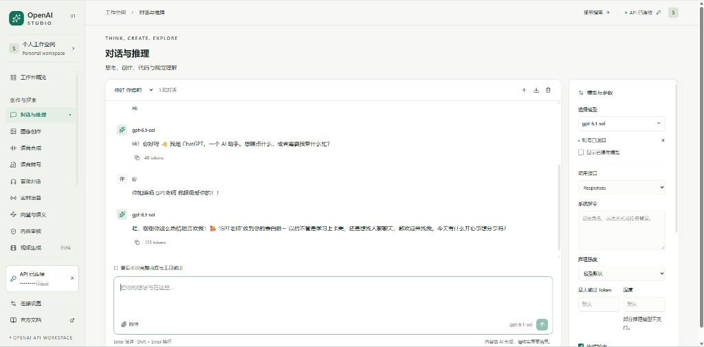
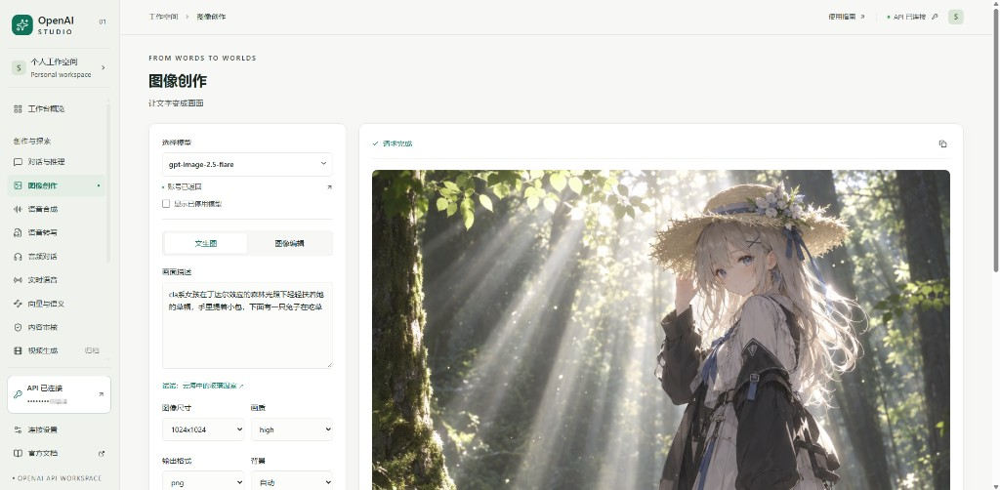

# OpenAI Studio · 多模型工作台

中文界面的 OpenAI API 工作台。连接设置里填写一次 API Key，对话、图像和其余栏目共用同一份服务端加密会话。官方资料核对日期：2026-10-29。

## 示例

对话与推理（`gpt-6.1-sol`）：



图像创作（`gpt-image-2.5-flare`，结果以图片预览，保存时下载 PNG）：



## 本地使用

需要 Node.js 22.13 或更新版本。

1. 确认本机 HTTP 代理已打开，端口是 **7892** 或 **7897**（例如 Clash）。工作台会探测这两个端口，用正在监听的那个访问 OpenAI。
2. 双击「启动工作台.cmd」，或在项目目录运行下面的命令。
3. 打开 http://127.0.0.1:5173/#settings 。
4. 填写自己的 OpenAI API Key，点击「保存并测试连接」。保存时只查询 `/models`，不会自动发起付费生成。

```bash
npm ci
npm run setup:local
npm run dev
```

`setup:local` 会在被 Git 忽略的 `.dev.vars` 里写入本机 `SESSION_SECRET`，以及：

```text
OPENAI_STUDIO_PROXY=http://127.0.0.1:7892,http://127.0.0.1:7897
```

不要设置 `HTTP_PROXY` 或 `HTTPS_PROXY`。Cloudflare 本地运行时会把这两个变量套到全部请求上，页面会无法打开。API Key 只在界面里输入，不要写进源码。

关闭终端会停止本地服务器。端口被占用时，使用启动日志里实际打印的地址。

## 目录

运行所需的目录保持在 Vinext / Cloudflare 约定的位置，没有把页面或 Worker 入口挪走。

| 路径 | 作用 |
| --- | --- |
| `app/` | 页面入口和全局样式 |
| `components/studio/` | 工作台界面：对话、图像、语音、设置等 |
| `lib/studio/` | 会话加密、请求转发、模型目录、对话载荷 |
| `lib/generated/` | 从官方文档提取的模型与接口索引 |
| `worker/index.ts` | 生产环境的 `/api/studio` 入口 |
| `scripts/` | 本地启动、测试、Vite 插件；开发时代理转发在 `scripts/vite/studio-local-api-plugin.mjs` |
| `docs/reference/` | 官方模型与接口资料摘录 |
| `docs/screenshots/` | 本说明用的界面示例图 |
| `public/` | 静态资源 |
| `.dev.vars` | 本机密钥与代理，已被忽略，不要提交 |

`components/ui/` 是界面组件库，工作台主流程不直接依赖其中大部分组件。`启动工作台.cmd` 留在仓库根目录，方便双击启动。

生成目录 `dist/`、`.next/`、`.wrangler/`、`.vinext/` 和 `node_modules/` 都已忽略，不需要整理进源码树。

## 栏目

| 栏目 | 可用操作 |
| --- | --- |
| 对话与推理 | Responses、Chat Completions 与旧版 Completions；多轮对话、图片/PDF、流式输出、停止、推理强度、系统指令、JSON Schema |
| 内置工具 | 按模型显示联网搜索、代码解释器、图像生成、知识库检索 |
| 图像创作 | 文生图、参考图编辑、蒙版、尺寸、质量、透明背景；预览图片，保存为 PNG |
| 语音合成 | 声音、语速、表达指令、输出格式、试听与下载 |
| 语音转写 | 音频上传、语言提示、Whisper 英译、字幕和说话人格式 |
| 音频对话 | 音频输入/输出，文字和语音回复 |
| 实时语音 | Realtime WebRTC、GPT-Live、实时翻译、WebSocket 实时转写 |
| 向量与语义 | 单条或批量文本、维度、余弦相似度 |
| 内容审核 | 文本/图像审核、风险标记和分类评分 |
| 视频生成 | Sora 与 Videos API 的停用说明；有权限的账号可查询历史任务 |
| 文件与知识库 | 文件上传与下载；向量库的创建、查询、检索 |
| 批处理与训练 | JSONL 示例、批处理、微调任务和评估兼容接口 |
| 模型目录 | 官方条目、快照、停用状态，以及账号 `/models` 同步 |
| API 实验室 | 官方路径索引、JSON / 表单 / 文本请求、二进制响应下载 |
| 调用记录 | 浏览器里最近 200 次请求的状态、耗时、Request ID 和用量 |

模型清单来自官方目录和各模型详情页。原文在 `docs/reference`，提取后的能力表在 `lib/generated/models.json`。

## 能力边界

- 目录里同时有可用、受限、待停用和已停用模型。已停用模型不能继续调用。
- `/models` 返回某个 ID，不代表每种调用方式都有权限。生成仍受 Key、地区、余额、限流和服务状态影响。
- 工作台只把请求发到 `api.openai.com`、`us.api.openai.com` 或 `eu.api.openai.com`，不能把第三方中转地址填进 API 区域。本机 7892 / 7897 只是访问官方 API 的出站代理。
- 自定义函数、computer use、shell、MCP 等外部执行环境由使用者自己提供。工作台不会在电脑上自动执行模型返回的命令。
- Sora 2 和 Videos API 已于 2026-09-24 关闭。没有 API Key 时可以浏览界面，不能得到真实结果。
- 停止请求不能保证撤销已经开始计费的上游调用。

## 配置和隐私

- `SESSION_SECRET` 只存在于本机 `.dev.vars`。生产环境用部署平台的加密 Secret，不要提交真实值。
- API Key 由服务端 AES-GCM 加密后放进 HttpOnly、SameSite=Strict Cookie。源码、`.dev.vars` 和 localStorage 里都没有这份 Key。
- 勾选「记住」后 Cookie 保留 30 天；否则随浏览器会话结束，解密后最长 24 小时。
- 对话（含附件）在当前浏览器的 IndexedDB；调用元数据在 localStorage。可以在界面里删除或导出。
- `.env.example` 只有空的 `SESSION_SECRET`。测试用的 `sk-test-...` 是假 Key。`seedy@sites.test` 是本地预览占位账号，不是真实邮箱。

## 检查

```bash
npm run typecheck
npm test
npm run build
```

开发服务器使用 Vinext。本地 `/api/studio` 由 Vite 插件在 Node 里转发，以便走 `OPENAI_STUDIO_PROXY`。生产构建仍从 `worker/index.ts` 进入同一套会话逻辑。

绑定类型可用下面的命令重新生成：

```bash
npx wrangler types worker-configuration.d.ts --config wrangler.types.jsonc --include-runtime false
```

## 官方资料

- [模型目录](https://developers.openai.com/api/docs/models)
- [API Reference](https://developers.openai.com/api/reference/overview)
- [停用时间表](https://developers.openai.com/api/docs/deprecations)
- [Responses 与文本](https://developers.openai.com/api/docs/guides/text)
- [图像生成](https://developers.openai.com/api/docs/guides/image-generation)
- [实时语音](https://developers.openai.com/api/docs/guides/realtime)
- [GPT-Live](https://developers.openai.com/api/docs/guides/live)
- [实时转写](https://developers.openai.com/api/docs/guides/realtime-transcription)
